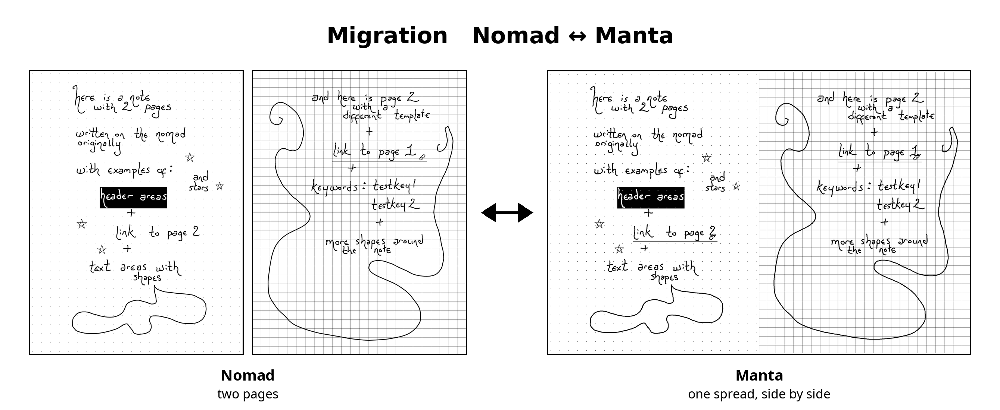

# Migration

*Nomad ↔ Manta*



A Supernote plugin that reshapes a note to fit whichever device you're holding.

Write on the **Nomad** (A6 X2), and Migration turns each pair of pages into one **Manta** (A5 X2)
landscape page, side by side, like an open notebook. Write more on the Manta, and Migration turns it
back into Nomad pages. Your handwriting keeps its shape, your pen keeps its weight, and your template
comes along.

## What it does

- **Two Nomad pages ⇄ one Manta page.** On the Manta, pages sit side by side at 91% of their Nomad
  size, so handwriting looks almost exactly the same physical size on both devices. A thin outline
  marks each page.
- **Reshapes the note in place.** The note keeps its name and place. Nothing is duplicated, and
  sync sees an ordinary edit.
- **Keeps your pen true.** A 0.5 line is still a 0.5 line on the other device, as if you'd written
  it there. Pressure, pen angle and pen type all carry over.
- **Brings your template.** On the Manta, each page shows its template behind the writing, lined
  up with it. Back on the Nomad, the page gets the real template again. This works for built-in
  templates and for your own templates in `MyStyle`.
- **Optional backup.** Keep a copy of the note as it was before each change.

## Using it

1. [**Download `Migration.snplg`**](https://github.com/marekrzajac/supernote-migration/releases/latest/download/Migration.snplg)
   and copy it to your device, then go to **Settings → Apps → Plugins →
   Add Plugin**. Allow the file permissions it asks for. Choose **Always allow**, or it will ask
   every time.
2. Open a note, tap the **Plugins** button in the sidebar, then choose **Migration**.
3. Tap the direction:
   - on the **Manta**, a Nomad note → **Nomad → Manta**
   - on the **Nomad**, a Manta note → **Manta → Nomad**
4. Wait a few seconds. The note reopens in its new shape.

**Backup before change?** toggles a backup of the original (solid black = on).

Each device translates *into its own* page size, so the other direction's button is greyed out.
Translate on the device you're about to write on.

## What travels

Everything on the page:

- **Handwriting**, with pressure, pen angle and pen type
- **Shapes** from the shape tool, and **stars**
- **Text boxes**, scaled with the page so they wrap the same way
- **Titles**, still attached to the writing they mark
- **Links**: links to another page of the same note are re-pointed to where that page now is
- **Keywords**, back on the page they came from
- **Pictures**, and the page's **template**
- **Blank pages** you've added

If a note ever contains something Migration doesn't recognise, it leaves the note untouched and
tells you, rather than lose it.

Links to a page of the same note are added a moment after the note reopens, so they can appear a
second or two after the writing. Links *from other notes* into a translated note need re-making:
the translated note is a new file inside, so their target no longer matches.

## Where it keeps things

Everything lives in one visible folder, **`EXPORT/Migration/`**:

- `backups/`: originals, when *Backup before change?* is on
- `settings/`: remembers your backup choice
- a temporary `translating.note` and template images, only during a translation

Custom templates are used straight from `MyStyle/`. Pictures and backgrounds are stored inside the
note itself, so a translated note doesn't depend on any other file.

## Syncing between devices

Migration works on the files on your device, so it works with whichever sync you use. It has been
tested with **Google Drive**. For custom templates to appear on both devices, `MyStyle` needs to sync
too. Give the sync a moment to finish before translating on the other device, to avoid conflict copies.

## Permissions

| Permission | Why |
|---|---|
| Read files | to read the note you have open |
| Write files | to write the reshaped note and backups |
| Delete files | to replace the note in place and remove temporary files |

Migration never uses the network.

## Building from source

Migration is a React Native plugin built with Supernote's
[plugin SDK](https://docs.supernote.com) (`sn-plugin-lib` 0.2.3, React Native 0.79.2).

```bash
npm install
./buildPlugin.sh            # → build/outputs/NomadManta.snplg
```

`dev.sh` builds, names the output `Migration.snplg`, and pushes it to both devices over adb. Copy
`dev.local.sh.example` to `dev.local.sh` and fill in your devices' adb serials first. Both
devices report the same model name, so `dev.sh` tells them apart by serial.

```bash
./dev.sh            # build and push to both devices
./dev.sh log manta  # stream the plugin's log
```

## How it works

The code is in [`lib/translate.ts`](lib/translate.ts). In short:

- Plugin coordinates are screen pixels on the page (`sn-plugin-lib` > 0.1.65), so the
  transform is a scale and an offset per page slot, and its exact inverse. A round trip lands
  within a pixel and doesn't drift.
- A note's page size can't change, so the plugin builds a fresh note at the new size and copies it
  over the original.
- Each page's template is placed as a picture scaled into its slot and tagged with the template's
  name, so the other direction can apply the real template again.
- Some pages are stored internally at a different size from the one shown. Line widths on those
  pages are corrected so pens stay true.

## License

Migration is free software, released under the [MIT License](LICENSE). You're free to use,
change and share it; just keep the copyright notice with it.
